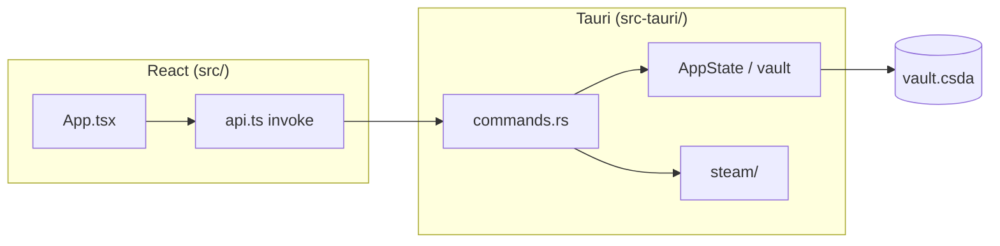

# Архитектура

## Общая схема

## Frontend (`src/`)

| Файл / папка | Роль |
|--------------|------|
| `App.tsx` | Shell, вкладки, vault unlock, главная |
| `ConfirmationsPage.tsx` | Подтверждения, повторный вход, импорт maFile |
| `api.ts` | Типы и обёртки `invoke()` над Rust-командами |
| `i18n.ts` | Локализация RU/EN |
| `biometricVault.ts` | Биометрия (mobile) |
| `updater.ts` | Проверка релиза на GitHub (desktop) |
| `MobileTransfer*.tsx` | QR-перенос vault на телефон |

## Backend (`src-tauri/src/`)

| Модуль | Роль |
|--------|------|
| `lib.rs` | Регистрация команд и плагинов Tauri |
| `commands.rs` | IPC: vault, аккаунты, guard, confirmations, события |
| `state.rs` | Заблокированное/разблокированное состояние, журнал событий |
| `vault/` | Argon2id + AES-GCM, файл `vault.csda` |
| `steam/` | Коды, сессия, setup, confirmations |
| `steam/session.rs` | Повторный вход для обновления JWT |
| `mobile_transfer.rs` | Шифрованный перенос на мобильное приложение |

## Vault

- Один зашифрованный файл на устройстве.
- Внутри: аккаунты (shared/identity, опционально tokens), настройки, до 50 событий.
- Секреты не отдаются в UI — только коды и флаги `has_session` / `has_identity`.

## Версия

Единый источник: `package.json` → `scripts/sync-version.mjs` → Tauri, Cargo, строки версии в выбранных `.md`.

В UI: `src/version.ts` (генерируется/читается при сборке).

## Плагины Tauri

- `dialog`, `opener`, `os`, `deep-link`, `biometric` (mobile)

## CI

См. [.github/CI-PIPELINE.md](../.github/CI-PIPELINE.md) и `build-release.yml`.
